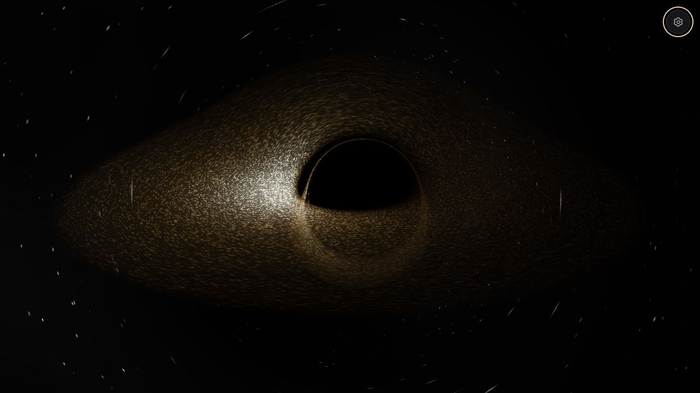

<div align="center">

# Interstellar · 黑洞观测站

**在 Kerr–Klein–Newman 时空里逐条积分零测地线，沿完整光路做有限体积广义相对论辐射传输（GRRT）的中文交互式黑洞展览。**

纯静态站点 · 无构建步骤 · 无第三方运行时依赖

[](#requirements)

[](#scenes)

[](https://github.com/RaSteaks/Interstellar)




</div>

---


<a id="features"></a>

## ✨ 项目亮点

| 能力 | 说明 |
| --- | --- |
| 🌌 **实时光线积分** | 入向／外向双 Kerr–Schild 坐标图，Bogacki–Shampine 3(2) 嵌入步进（FSAL 复用接受终点），未收敛与无效光线显式区分。 |
| 🔥 **物理辐射传输** | 热同步辐射、吸收、法拉第旋转与转换、四分量 Stokes 矩阵指数；纯强度热盘另走独立标量核，不构建偏振基底。 |
| 🖼️ **按需显示与静止细化** | 画面无变化时停止合成，曝光复用辐射与光晕缓存；交互预算由有效 GPU 计时控制，暂停后最多四次对称子像素采样改善细节，随后只在阴影边缘、光子环等相干边缘处追加更细的光线。每次采样保持原精细分辨率，完整细化的总光线数为单次的四倍，边缘加密另计；交互时用邻域限幅的时间累积抑制边缘爬行。显示链保持色相、使用标准 sRGB 与抖动。 |
| 🛰️ **类时观察者** | E=1、L=0 的自由落体世界线，按固有时间推进，含运动像差与频移；也可选视界外静止观察者。 |
| 🎬 **10 个场景预设** | 光学热盘、射电热流、喷流、逆行盘、带电黑洞与规定轨道热点，完整列表见[场景预设](#scenes)表。 |
| 🧾 **本地生成的 GRMHD 片段** | 由固定提交的 Illinois iharm2d_v3 产出；站点只分发数值记录与来源说明，不含上游求解器源码。 |
| ⏱️ **热流持续求解（t=800 起）** | 以 t=800 的 float64 检查点为起点，在单个 Worker 内用双精度 Wasm 延续求解；快照固定按 20 GM/c³ 间隔记录，动态历史保留 128 槽。求解不足时冻结在最后一个完整事件并显示等待，不标称持续求解。 |
| ♿ **可访问性与偏好** | 默认收起的原生 details 面板、原生 select/range、完整键盘路径、Esc 收起并归还焦点，跟随系统「减少动态效果」偏好。 |

<a id="toc"></a>

## 🗺️ 目录

- [项目亮点](#features)
- [场景预设](#scenes)
- [快速开始](#quickstart)
  - [运行环境要求](#requirements)
- [作品集 iframe 预览](#preview)
- [科学模型与代码位置](#architecture)
- [检查与验证](#checks)
- [GRMHD 数据与可复现性](#grmhd)
- [已知边界与简化](#limitations)
- [目录结构](#layout)
- [文档与许可](#docs)

<a id="scenes"></a>

## 🕳️ 场景预设

| 预设 | 吸积流 | 说明 |
| --- | --- | --- |
| 类星体 · 光学热盘 | 热盘 | 超大质量黑洞，按可见光波段显色 |
| 恒星级 · X 射线热盘 | 热盘 | 按 X 射线波段显色 |
| M87\* · 射电热流与喷流 | GRMHD | 230 GHz，偏振可用 |
| 银河系中心 · 射电热流 | GRMHD | 230 GHz，显示增益 200（仅显示归一化，不代表光度标定） |
| 喷流基部 · 侧面观察 | GRMHD | 侧面视角观察喷流基部 |
| 逆行盘 · 反向自旋 | 热盘 | 自旋 a 为负 |
| 近极端克尔 · 内缘与细环 | 热盘 | 自旋 a=0.998（无量纲） |
| 孤立黑洞 · 星空透镜 | 无盘 | 只留引力透镜星空，不渲染吸积流 |
| 带电黑洞 · 理论对照 | 热盘 | Kerr–Newman 度规，电荷 Q≠0 |
| 轨道热点 · 光路时延示例 | 热盘 | 规定方位热点，展示光路时延 |

<a id="quickstart"></a>

## 🚀 快速开始

发布产物就是 `dist/`，直接静态服务即可（`.openai/hosting.json` 也指向该目录）：

```bash
python3 -m http.server 8765 --bind 127.0.0.1
# 打开 http://127.0.0.1:8765/dist/
```

重新生成 GRMHD 片段与运行时是可选步骤（仓库已包含产物）。`generate-grmhd.py` 需要 `git` 与 `clang`；`build-grmhd-runtime.py` 需要带 `wasm32-unknown-unknown` target 的 `rustc`：

```bash
# 方式一：不传 --source，脚本在临时目录克隆固定提交，改写为 64×64、t=0..800 后编译运行，用完即删
python3 tools/generate-grmhd.py

# 方式二：复用已跑完的 iharm2d_v3 检出目录；脚本校验其 HEAD 必须等于固定提交，否则报错退出
python3 tools/generate-grmhd.py --source ~/iharm2d_v3

# 验证 t=800 的 canonical float64 检查点，并编译 wasm 与 native（--skip-native 可只出 wasm）
python3 tools/build-grmhd-runtime.py
```

<a id="requirements"></a>

### 运行环境要求

> **WebGL2 必需。** 浏览器需支持 WebGL2 与 `EXT_color_buffer_float` 扩展。二者缺少其一时自动进入 Canvas 兼容投影，界面会明确标注：该路径不含引力透镜，也不计算视界内观察。

> **安全上下文必需。** GRMHD 场景首次使用时会下载 `dist/data/grmhd-torus.f32.gz`（7,193,290 字节，6.9 MiB）并按元数据校验 SHA-256，需要 `DecompressionStream` 与 `SubtleCrypto`，即安全上下文（`localhost` 或 https）。校验失败会在面板中报告，而不是静默降级。

> **热流场景为按需加载。** 首次播放还会加载 `dist/data/grmhd-torus.checkpoint.bin.gz`（359,400 字节）与 `dist/solver/grmhd-runtime.wasm`（1,731,097 字节）；检查点恢复失败、Worker 异常或 Wasm 加载失败会明确回退到 t=0–800 的有限播放，不会标称持续求解。

<a id="preview"></a>

## 作品集 iframe 预览

`/preview` 可直接访问和刷新；以 `dist/` 为站点根目录、使用 Cloudflare 默认 HTML 路径处理时，目录文档 `dist/preview/index.html` 的最终地址为 **`/preview/`**，`/preview` 会重定向到该地址。当前 Sites 域名下的地址为 `https://interstellar.rasteaks.chatgpt.site/preview/`。

预览复用公开的 `dist/screenshot.jpeg` 和 `dist/styles.css` 中的主题变量，布局由 `dist/preview.css` 独立维护。以 1280×800 的黑洞画面为主体，下方保留项目名和简短说明；也支持较小的直接访问视口。它不加载 `app.js`、WebGL、GRMHD 数据或求解 Worker，没有登录、Cookie、Referer、父窗口 DOM 或交互依赖，不播放媒体、不发起写操作。图片失败或 JavaScript 关闭时，项目名与说明仍可展示。

### 嵌入策略与托管

`dist/_headers` 为支持该文件的静态托管声明三个精确路径：`/preview`、`/preview/` 和 `/preview/index.html`，期望最终文档发送：

```http
Content-Security-Policy: frame-ancestors 'self' https://blog.rasteaks.cn:8443
X-Robots-Tag: noindex
```

规则要求在相同路径移除 `X-Frame-Options`，由 `frame-ancestors` 限制嵌入；端口 **8443** 是允许 Origin 的一部分。预览 HTML 也包含 `robots=noindex`，没有加入 sitemap。`noindex` 只控制索引，预览内容仍是公开内容。首页、资源及其它路径的响应头保持原样。

仓库没有 Worker/SSR 入口、全局 CSP/X-Frame-Options 或代理配置，`.openai/hosting.json` 仍原样发布 `dist/`；必须把 `_headers` 一同交给支持该文件的静态资产层。Cloudflare 的规则解析、路径规范化与响应头行为分别见[静态资源响应头文档](https://developers.cloudflare.com/workers/static-assets/headers/)和[HTML 路径文档](https://developers.cloudflare.com/workers/static-assets/routing/advanced/html-handling/)。这里没有增加按请求执行的 Worker、存储或付费服务。

2026-10-31 已发布并验证 Sites 版本 17：预览及真实博客 Origin 的 iframe 显示正常，首页结构和公开资源保持一致；但当前 Sites 静态托管将 `_headers` 当普通文件返回，**未应用其中的 CSP 或 X-Robots-Tag**。预览的 HTML `robots=noindex` 仍存在，X-Frame-Options 未发送，但未允许的 Origin 也能嵌入，因此限定父站点的要求尚未在生产生效。实际响应、正反向浏览器验证及截图保存在 `verification/preview/production/`。

仓库不控制 Sites/CDN 的上游规则。Cloudflare 本地运行时处理 `_headers` 的成功结果不能代替 Sites 生产验证；修复托管支持或变更部署入口后，需再次检查预览文档的最终 GET 响应：

```bash
curl -sS -L -D - -o /dev/null https://interstellar.rasteaks.chatgpt.site/preview
```

若托管平台不处理 `_headers`，需在该平台的静态响应配置中，**仅为上述三个预览路径**设置同等 CSP、移除 X-Frame-Options 并添加 X-Robots-Tag。若 CDN、反向代理或 Cloudflare Transform Rules 另有 CSP，只调整预览路径在原策略中的 `frame-ancestors`，保留其他指令；不要追加一条 CSP 来试图覆盖旧策略，也不要放宽首页或其它路径。后续若改由 Worker 动态返回 HTML，须在对应 Response 中设置这些头，不能依赖静态 `_headers`。

父站点可以使用以下配置；等比例缩小时保留 iframe 的 1280×800 内部尺寸，再由父站点缩放整个元素：

```html
<iframe
  src="https://interstellar.rasteaks.chatgpt.site/preview/"
  title="Interstellar 黑洞观测站作品预览"
  width="1280"
  height="800"
  sandbox="allow-scripts allow-same-origin"
  referrerpolicy="no-referrer"
></iframe>
```

若父站点有 CSP，它自己的 `frame-src` 也须允许 `https://interstellar.rasteaks.chatgpt.site`；本仓库不修改父站点。无需增加 CORS 白名单。

### 本地验证与发布流程

没有新增构建步骤或项目依赖；发布产物仍是已经可用的 `dist/`。部署继续使用现有 Sites 的版本保存与发布流程（仓库未定义 CLI 部署命令），无需改为 Worker 项目。本地验证使用宿主机工具，禁止启动历史检查脚本中的 Chrome runner：

```bash
# 从仓库根目录启动 Cloudflare 本地静态资产服务；不执行部署。
npx wrangler@4 dev --assets ./dist --port 18765 --ip 127.0.0.1

# 在另一个终端运行，PLAYWRIGHT_MODULE 指向宿主机已有的 Playwright 包。
PLAYWRIGHT_MODULE=/path/to/playwright node checks/preview.cjs http://127.0.0.1:18765
# 如已安装 Firefox，也可选择 PREVIEW_BROWSER=firefox；默认 headless WebKit。
```

普通 `python3 -m http.server` 可以查看 HTML，但不会解析 `_headers`，不能作为安全响应头验证。`checks/preview.cjs` 验证实际 GET/重定向、唯一 CSP、无 X-Frame-Options、noindex、1280×800/640×400/390×844 布局、无图无 JS 降级及首页控件。嵌入用隔离的 HTTPS 测试父文档保留精确 Origin 与上述 sandbox/referrerpolicy，转发本地资产响应而不改 CSP：允许 8443、同源与 0.5 倍缩放，拒绝错误端口和其它 Origin。它不访问真实博客，也不修改正式白名单；截图、响应头和报告保存在被忽略的 `verification/preview/`。本地成功不代表真实父站点或新页面的生产验证通过。

<a id="architecture"></a>

## 🧮 科学模型与代码位置

| 文件 | 职责 |
| --- | --- |
| `dist/relativity.js` | 双 Kerr–Schild 坐标、带电与正负自旋、带误差估计的积分、类时观察者、偏振向量的平行移动 |
| `dist/astrophysics.js` | 物理质量／吸积率、广义薄盘通量、混合气体／辐射压力与熵守恒内流、Planck 与 CIE 光谱、自由落体世界线与取景 |
| `dist/plasma.js` | 热同步辐射、吸收、法拉第旋转／转换、四分量 Stokes 矩阵指数、经 SHA-256 核验的 GRMHD 读取 |
| `dist/physical-renderer.js` | WebGL2 有限体积光线传输求解器与显示链，唯一的 WebGL2 渲染路径 |
| `dist/grmhd-worker.js` / `dist/grmhd-continuation.js` | 单 Worker 求解会话、暂停/重置/销毁、可转移快照与 128 槽缓存 |
| `dist/solver/grmhd-runtime.wasm` / `dist/solver/grmhd-runtime.js` | 预编译的双精度延续求解 ABI，以及 MIME 回退加载器 |
| `dist/app.js` | 共享状态、参数校验与原子应用、页面生命周期与可见性、空闲绕转抑制，以及可选的 `document.modelContext` 工具注册（实验性接口，注册失败即跳过） |
| `dist/navigation.js` | 统一 Pointer／Wheel／GestureEvent 手势、缩放边界、镜头缓动、空闲绕转步进 |
| `dist/physics.js`、`dist/geodesics.js`、`dist/raytracer.js` | 保留的历史基准，以及 WebGL2 不可用时 Canvas 兼容画面所共享的科学核心 |
| `tools/generate-grmhd.py` | 可复现地生成并打包 GRMHD 片段与元数据 |
| `dist/notices.txt` | 参考来源与第三方许可 |

逐效果的数学模型、代码位置、文献出处与已知简化写在 [`PHYSICS.md`](PHYSICS.md)；主题、控件约定与 token 映射见 [`DESIGN.md`](DESIGN.md)；方案与实现记录见 [`AGENT.md`](AGENT.md)。

<a id="checks"></a>

## ✅ 检查与验证

科学核心与交互逻辑用无依赖的 Node 检查（不需要浏览器）：

```bash
node checks/physical-core.cjs      # ISCO、96 组类时观察者与注入、双图零标架、哈密顿梯度、捕获边界、守恒逃逸、固有时间落体、质量守恒、光谱、Stokes 传输、GRMHD 记录完整性
node checks/render-physics.cjs     # 历史渲染核心：盘面分布、观察者标架、零测地线、着色器结构 lint
node checks/navigation.cjs         # 手势、去重、缩放边界、缓动、近视界标架
node checks/idle-drift.cjs         # 空闲绕转、指针／原生手势生命周期、预设与参数原子拒绝、旅程恢复
node checks/plunge-particles.cjs   # 坠落类时归一化、E/L 守恒、近视界频移、轨迹单调性
node checks/continuous-solver.cjs  # t=800 恢复、native/Wasm 对照、t=1600 有限新状态
node checks/grmhd-worker.cjs       # 逐帧目标、固定 20 GM/c³ 快照间隔、背压、环形缓存和重置
```

真实 GPU 的浏览器检查需要两项本机资源，都不写入项目依赖：

1. **Playwright 与本机 Chrome**：用环境变量 `PLAYWRIGHT_MODULE` 指向宿主机上已安装的 playwright 包目录，`CHROME_EXECUTABLE` 指向本机 Chrome 可执行文件。
2. **本地静态服务**：端口 8765 服务仓库根目录（用户页面为 `/dist/`，检查页面为 `/checks/`）。固定预算对照另需端口 8766 服务 `verification/thermal/baseline/`，即此前运行保存的原始快照（该目录已被 `.gitignore` 忽略）；独立回归检查不需要基线服务。

```bash
export PLAYWRIGHT_MODULE=~/node_modules/playwright   # 宿主机上已安装的包目录，含 package.json
node checks/physical-browser.cjs http://127.0.0.1:8765
node checks/render-performance.cjs http://127.0.0.1:8765
node checks/mobile-controls.cjs http://127.0.0.1:8765
THERMAL_SKIP_PERFORMANCE=1 node checks/thermal-acceptance.cjs http://127.0.0.1:8765 http://127.0.0.1:8766
node checks/thermal-performance.cjs http://127.0.0.1:8765 http://127.0.0.1:8766
```

> **判定口径：** 所有场景的未收敛光线与无效光线必须为 0；GPU 浮点系数与双精度 CPU 对照的相对差 <0.1%；偏振误差 <1e-5，且 GRMHD 场景的偏振度 >0.01；逐变体断言实际光线数与积分档位一致（转换矩阵的 Stokes 光锥约束在 `physical-core.cjs` 中独立验证）。完整数值、截图与复现记录写入被忽略的 `verification/`。

`render-performance.cjs` 运行真实 WebGL 提交检查，覆盖静止零绘制、曝光缓存、有限渐进采样、独立子像素积分的 radiance/Stokes 均值、运动/时间/尺寸失效、历史诊断来源与最新完整计数、GPU计时失效回退/恢复，以及缺少浮点线性过滤扩展时的真实着色器。报告位于 `verification/render-performance/`。科学数值检查仍固定单条像素中心光线；四次静止采样是展示抗锯齿，不代表单次光线积分加速。

`mobile-controls.cjs` 检查320/390/430px触控视口中的关闭按钮与读数分离、原生下拉与触控尺寸、滚动和短窗口操作可达性、关闭重开后的参数保留、减少动态效果、尺寸通知与全屏能力回退。求解详情位于“模型与参考”分组，手机底部只保留操作、当前状态和反馈；不支持原生全屏时隐藏该按钮。报告与截图位于 `verification/mobile-controls/`。浏览器触控模拟不替代真实iPhone Safari设备复核。

2026-10-07的同设备、同2048 r_g域固定预算对照中，曝光合成GPU中位耗时从0.7675ms降到0.126541ms（约83.5%），重复静止帧停止GPU提交；单次追踪耗时没有明确加速结论。完整方法与分项在本地复现产物 `verification/render-performance/fixed-budget/performance-interleaved.json`，与下方历史热盘性能报告分别保存。

<a id="grmhd"></a>

## 🔭 GRMHD 数据与可复现性

`dist/data/grmhd-torus.*` 是本地生成的轴对称片段，不是外部下载的观测数据：

- 由 `tools/generate-grmhd.py` 在临时目录克隆并固定 `AFD-Illinois/iharm2d_v3` 提交 `bfa06d2cbabf2c8cd94c1711d04fd468397e9aee`，以 64×64 网格、自旋 a=0.9375、电荷 Q=0、t=0..800 运行。
- 站点只分发 41 帧数值记录（t=0–800，间隔 20 GM/c³，含密度、内能、四速度与磁场分量）与其来源说明，**不打包上游求解器源码**；压缩包 7,193,290 字节（6.9 MiB），解压后 8,060,928 字节（7.7 MiB）。
- `tools/generate-grmhd.py` 从上游末帧生成 float64 `GRMHDCP1` 检查点（含完整状态和两条边界行）；`tools/build-grmhd-runtime.py` 只验证这份 canonical checkpoint，不会把 float32 展示历史重新提升为 float64，然后从同一 Rust 源码生成 native/Wasm。浏览器端 t>800 的延续求解使用守恒标量有限体积推进，但尚不是完整重新编译的 iharm2d_v3 长程 GRMHD。
- 元数据记录 `sha256`、字节数、精度、时间、形状与三项误差，本次产出为 maxDivB 1.20×10⁻¹²、四速度归一化误差 2.04×10⁻¹⁴、磁场正交性误差 1.55×10⁻¹⁵；浏览器侧缺少哈希或形状不匹配时 fail closed，校验后才使用。`node checks/physical-core.cjs` 会重新校验二进制与元数据的一致性。
- 记录的极向拉伸系数 `thetaSlope` 必须与生成器写入数据时所用的一致，检查中有对应断言。

<a id="limitations"></a>

## ⚠️ 已知边界与简化

本项目刻意不宣称超出其实现范围的能力，当前明确的保留项：

- GRMHD 历史为 **64×64、轴对称、有限片段**（t=0–800）；浏览器端 t>800 的延续求解只用于验证 Worker／Wasm／缓存架构，未宣称完整上游 GRMHD 继续运行；未实现三维 GRRMHD，质量与吸积率也不是对 M87\* 或银河系中心的观测拟合。
- 电子温度与局部同步辐射为文献拟合处方；灰大气不含完整多次散射或返回辐射。
- 热盘是解析稳态模型，含有限内缘应力、灰消光与注入速度三类模型参数，不由 MRI 自洽导出。
- 采样以有限光线预算推进，未收敛／无效光线作为显式状态报告，不混入阴影。
- 两项已声明未达标的验收项。其一，0° 侧视的边界图像在 2048 r_g 域下仍未收敛。其二，扩域到 2048 r_g 后的净性能目标 25% 未达到，实测净下降 10.9%（拖动）与 22.9%（自旋）；该数据在 Apple M3 Max、Chrome Metal 后端下以 12 次预热 + 31 次交错测量取得，分项见 `verification/thermal/performance-interleaved.json`（本地复现产物，已被 `.gitignore` 忽略）。
- 曝光与显示增益只作用于显示阶段，不代表光度标定。

<a id="layout"></a>

## 🗂️ 目录结构

```
dist/         发布目录，唯一静态产物
checks/       Node 与浏览器检查
tools/        GRMHD 生成脚本
verification/ 检查证据与截图（已在 .gitignore 中忽略）
AGENT.md PHYSICS.md DESIGN.md  方案记录、科学依据、设计约定
```

<a id="docs"></a>

## 📚 文档与许可

| 文档 | 内容 |
| --- | --- |
| [`PHYSICS.md`](PHYSICS.md) | 逐效果的科学依据，含保留的简化与验收限制。 |
| [`DESIGN.md`](DESIGN.md) | 主题、语言、控件与动态效果约定。 |
| [`AGENT.md`](AGENT.md) | 方案与每轮实现记录。 |
| [`dist/notices.txt`](dist/notices.txt) | 参考来源与第三方许可全文。 |

`dist/notices.txt` 要点：`physics.js` 的 Page–Thorne 通量表达式改编自 grtrans（MIT，附完整声明）；NPGS 仅作为自适应积分与分阶段渲染的**参考**，未包含其源码（GPL-3.0）；oseiskar/black-hole（GPL）与 rantoniels/starless（MIT）作为背景透镜与多重星像的呈现参照；论文引用见该文件。

> 仓库当前没有顶层 `LICENSE` 文件，第三方组件的许可条款以上述 `dist/notices.txt` 为准。

<div align="center">
<sub><a href="https://github.com/RaSteaks/Interstellar">RaSteaks/Interstellar</a> · 用相对论辐射影像探索黑洞</sub>
</div>
